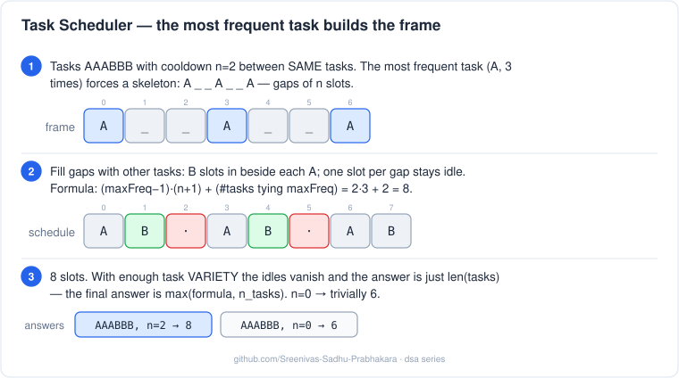

# Task Scheduler

> NeetCode 150 · Heap — no simulation needed: the most frequent task frames the schedule, and the answer is a two-case formula. Go, stdlib only, tested.

## Problem

Tasks (letters) on one CPU, identical tasks at least n slots apart, idling allowed. Minimum total slots? `AAABBB, n=2` → 8 (`AB_AB_AB`).

## Approach

Usually filed under heaps (simulate by always running the most-urgent available task), but the structure admits a closed form. Lay the most frequent task out first: maxFreq occurrences create maxFreq−1 gaps of width n, giving a frame of `(maxFreq−1)·(n+1)` slots plus a final row holding every task *tied* at maxFreq. Other tasks pour into the gaps — and if they overflow the frame, no idling is ever needed, so the answer floors at `len(tasks)`. `max(len(tasks), framed)` covers both regimes. The greedy-heap simulation gives the same number with 30 more lines; knowing when counting beats simulating is the lesson.

**Complexity:** O(tasks) time, O(26) space.

## Visual walkthrough

Read the picture top to bottom — each numbered frame is one moment of the algorithm
running on this repo's test example.

## Run

    go test ./...   # verify
    go run .        # demo

---

Part of a 275-repo DSA series in Go — Striver's SDE Sheet (dsa-001–191) plus the NeetCode 150 / Blind 75 additions (dsa-192–275), stdlib only, every solution tested. Browse: [`dsa-*` repos](https://github.com/Sreenivas-Sadhu-Prabhakara?tab=repositories&q=dsa-&type=source).
